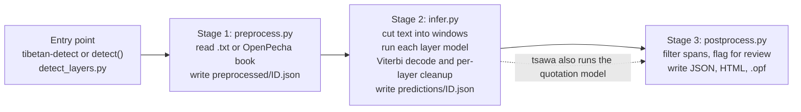
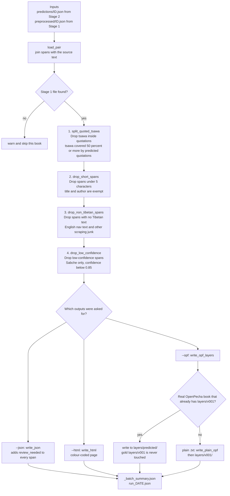

# Post-processing flow

How a book goes from raw text to final layer files, and which script runs when.
Package folder: `tibetan_layer_detection/`.

## 1. The three stages

Stage 2 runs the quotation model together with tsawa (`layers_for_run` in `infer.py`),
so Stage 3 can drop quoted tsawa. Title and author read only the first and last
3,000 characters and give one span each.

## 2. Stage 3 step by step (`postprocess.py`, `main()`)

## 3. Options that change the steps

| Option | Effect |
|---|---|
| `--keep-quoted-tsawa` | skip the quoted-tsawa drop |
| `--keep-low-confidence` | skip the low-confidence drop |
| `--review-threshold` | one number for every layer (default 0.7); a span below it is flagged review_needed |
| `--title-author-review-threshold` | review threshold for title and author only |
| `--title-author-opf` | also write title and author to `.opf` as `BookTitle.yml` and `Author.yml` |

## 4. Where each step lives

| Step | Function | File |
|---|---|---|
| Quoted tsawa drop | `split_quoted_tsawa` | `tibetan_layer_detection/postprocess.py` |
| Short-span drop | `drop_short_spans` | `tibetan_layer_detection/postprocess.py` |
| Non-Tibetan drop | `drop_non_tibetan_spans` | `tibetan_layer_detection/postprocess.py` |
| Low-confidence drop | `drop_low_confidence` | `tibetan_layer_detection/postprocess.py` |
| Review flags | `needs_review` | `tibetan_layer_detection/postprocess.py` |
| Layer settings | `LAYERS` | `tibetan_layer_detection/layer_config.py` |
