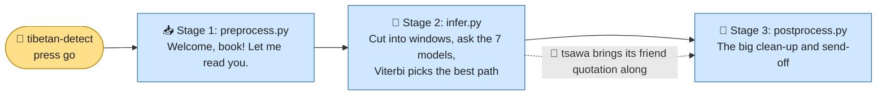
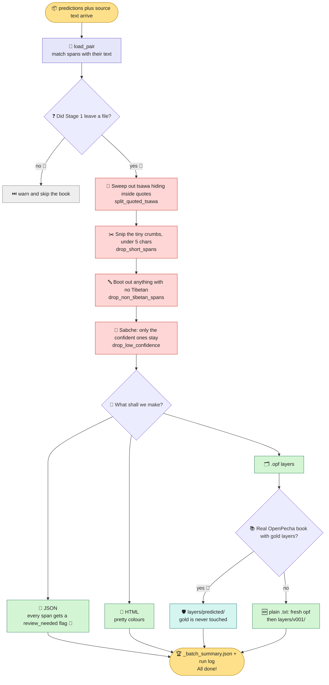

# Post-processing flow, the fun version 🎉

The same journey as the clean diagram, told like a day in the life of a book. 📖
Package folder: `tibetan_layer_detection/`.

## 🚂 The three stops

## 🧼 Stage 3: the clean-up crew

## 🎛️ Little switches

- 🙈 `--keep-quoted-tsawa`: keep the tsawa that hide in quotes
- 🙉 `--keep-low-confidence`: keep the unsure Sabche spans
- 🚩 `--review-threshold`: one number for every layer (default 0.7); a span below it is flagged review_needed
- 🎓 `--title-author-review-threshold`: a separate bar for title and author
- 🏷️ `--title-author-opf`: also write `BookTitle.yml` and `Author.yml`

## 🔎 Who does what

| Crew member | Function | File |
|---|---|---|
| 🧹 | `split_quoted_tsawa` | `tibetan_layer_detection/postprocess.py` |
| ✂️ | `drop_short_spans` (title and author are safe) | `tibetan_layer_detection/postprocess.py` |
| 🔤 | `drop_non_tibetan_spans` | `tibetan_layer_detection/postprocess.py` |
| 🎯 | `drop_low_confidence` (Sabche, 0.85) | `tibetan_layer_detection/postprocess.py` |
| 🚩 | `needs_review` | `tibetan_layer_detection/postprocess.py` |
